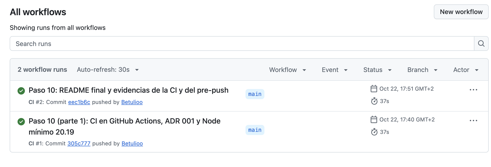

# azdo-daily-brief: informe diario verificable sobre Azure DevOps

**TFM — Desarrollo de software con IA: de una necesidad a una solución verificable**

- Autor: Luis Alberto Nuñez Matute
- Repositorio: `https://github.com/Betulioo/TFM-DEMO`
- Versión entregada: tag `v1.2` (el código es el de `v1.0`; `v1.2` añade este documento y sus evidencias)
- Dónde está la aportación: README, sección "Dónde está la aportación"

## Índice

1. Problema y contexto
2. Objetivo y alcance
3. Solución paso a paso
4. Verificación y resultados
5. Justificación de negocio
6. Reutilización y conclusiones

## 1. Problema y contexto

### La necesidad y a quién afecta

Trabajo como desarrollador en un proyecto de cliente que usa Azure DevOps (Repos para el código y las PRs, Boards
para las tareas del sprint). Cada mañana, antes de la daily, respondo a tres preguntas:

1. ¿Qué PRs esperan mi revisión o la de mi equipo, y cuáles están bloqueadas o envejecidas?
2. ¿En qué tareas de la iteración actual estoy y qué les falta?
3. ¿Qué riesgos tiene la iteración (tareas estancadas o bloqueadas, PRs envejecidas y PRs propias bloqueadas)?

Azure DevOps tiene esa información, pero repartida: las PRs en su lista (y sus votos y fechas, dentro de cada
una) y las tareas en el tablero, sin relación directa con su PR. Las señales que importan ("esta PR lleva días
sin revisar", "esta tarea está bloqueada") no aparecen en ningún sitio: las deduce quien mira. Afecta a cualquier
desarrollador de un equipo con daily en Azure DevOps. En mi caso, el cliente usa un proceso personalizado, así que
la solución no puede depender del proceso.

### Cómo se resuelve hoy

Lo resuelvo a mano. Lo medí en el proyecto del cliente durante 2 días, apuntando solo números
(`docs/medicion.md`, paso 0):

| | Día 1 | Día 2 |
|---|---|---|
| Minutos | 1 | 2–3 |
| PRs pendientes de mi revisión / del equipo | 0 / 2 | 2 / 2 |
| Mis tareas | 0 | 2 |
| Sitios consultados | 3 | 3 |
| Cambios de contexto | 1 | 1 |
| Dispersión percibida (1–5) | 2 | 3 |

El recorrido es siempre el mismo: lista de PRs, entro en la PR, salgo, voy al tablero y busco mi tarea. Por el
camino acabo leyendo algún comentario de otra PR. A veces llego a la daily sin haber revisado las PRs, aunque en
los dos días medidos no pasó.

**El problema no es el tiempo** (menos de 3 minutos con este volumen), sino que la información está **dispersa**
(3 sitios para 3 preguntas), que el recorrido **invita a distraerse**, que **es fácil saltárselo** y que **no queda
registro** de cómo estaba el sprint cada día. Son 2 días en vez de los 5 previstos: describen esos días, no una
línea base fiable (§5).

**Restricción:** mis cuentas de IA son personales, así que **ningún dato del cliente pasa por la IA**. La
herramienta se construye y se prueba sobre un proyecto demo de Azure DevOps y sobre datos ficticios.

## 2. Objetivo y alcance

**Objetivo:** responder las tres preguntas de §1 con **un solo informe**, en lugar de recorrer varias pantallas, y
que cada dato del informe se pueda **comprobar con código**: los hechos citan siempre su ID (`PR #12`, `WI #345`)
y están separados de las sugerencias.

El trabajo combina dos vías del enunciado:
- **Una herramienta nueva construida con IA:** la recogida de datos, la skill de informe y el verificador (§3.1–3.3).
- **Un arnés para trabajar con IA en el proyecto:** instrucciones, skills, agente revisor, lint, tests de
  arquitectura, pre-push y CI (§3.4–3.5). Incluye un proyecto demo de Azure DevOps sembrado con los casos de prueba.

**Qué queda fuera, y por qué:**

| Fuera del alcance | Motivo |
|---|---|
| Datos de cliente | Las cuentas de IA son personales: solo demo y fixtures. Del cliente, solo los números de la medición |
| Escribir en Azure DevOps | El cliente HTTP de `src/` solo implementa GET. Solo escribe el seed de la demo, con su propio token |
| Ramas ("crear rama", "abrir PR") | Lo retiré en el paso 6: traerse todas las ramas no escala y no responde a las tres preguntas |
| Ejecución programada | No se pide. El informe se genera desde Claude Code; `claude -p` (paso 8b) y Obsidian (8c) eran opcionales y no se han hecho |

## 3. Solución paso a paso

### 3.1 Arquitectura: la IA no toca la API

La solución se divide en cuatro fases. Solo una de ellas usa IA:

| Fase | Quién | Qué hace |
|---|---|---|
| Recogida | Código TypeScript (sin IA) | Consulta Azure DevOps (solo lectura) y escribe `output/snapshot.json` |
| Síntesis | Skill de Claude Code | Redacta el informe a partir del snapshot, citando IDs |
| Verificación | Código TypeScript | Compara el informe con los casos esperados |
| Decisión | Persona | Lee el informe y decide qué hacer |

La decisión está en el **ADR 001** (`docs/adr/001-recogida-determinista.md`): las reglas (siguiente paso, PR
envejecida, tarea estancada o bloqueada, vinculación tarea ↔ PR) se calculan en código y la IA solo prioriza y
redacta. Así el resultado de la IA se compara con datos que no dependen de ella, el token nunca pasa por la IA y
la solo lectura la comprueban el lint y un test. Descarté que la IA consultara la API con un MCP (no sería
reproducible y vería el token) y que calculara las reglas (son transiciones conocidas que el código resuelve igual
cada vez).

La recogida sigue una **arquitectura hexagonal**: un puerto (`src/ports/devops-source.ts`) con dos adaptadores, el
real (`src/adapters/azdo/`, con un cliente que **solo tiene `get`**) y uno falso (`src/adapters/fixtures/`) que
genera los datos desde `fixtures/expected.json` con fechas relativas. Las reglas (`src/domain/rules.ts`) no saben
qué adaptador se usa, así que la recogida entera se prueba sin red y la CI puede ejecutarla.

### 3.2 El dominio como contrato: glosario y casos esperados

Antes de escribir código se fijaron dos fuentes. Las comparten el código, la skill y el verificador:

- **`docs/glosario.md`**: define cada término ("PR envejecida", "PR bloqueada", "tarea estancada", "tarea
  bloqueada", "PR pendiente del equipo"…) y el **siguiente paso** de una tarea con PR. Ese siguiente paso son 6
  reglas en orden, de "Cerrar la tarea" a "Revisar estado". Los umbrales y las marcas de bloqueo se configuran
  en `.env`.
- **`fixtures/expected.json`**: es la única fuente de los 17 casos. El seed lee `setup` para crearlos en la demo,
  el adaptador falso los genera y el verificador lee `expected`. Así no hay dos listas que se puedan
  desincronizar.

Cada término del glosario tiene su regla en `src/domain/rules.ts` y sus tests. Cuando pedí una señal nueva,
"tarea bloqueada", el orden fue siempre el mismo: término en el glosario, casos P y Q en `expected.json`,
regla y tests, y línea en la skill.

### 3.3 El papel de la IA en el producto: la skill `daily-brief`

La síntesis es una skill de Claude Code (`.claude/skills/daily-brief/SKILL.md`). **Lee solo
`output/snapshot.json`** y **no recalcula nada**: copia las señales que ya trae (`aged`, `blocked`, `nextStep`…).
Los **hechos van siempre con ID**, enlazados con el `webUrl` del snapshot (nunca construye URLs); si falta un
campo escribe **"sin datos"**; y las **sugerencias** siguen un orden fijo y citan el ID del hecho en que se basan.
La **plantilla fija** de encabezados y textos de señal es lo que permite comprobar el informe con un script.

> **Figura 1.** Plantilla de `SKILL.md` de `daily-brief`, con marcadores que se rellenan con el snapshot. Muestra
> el contexto que recibe la IA y permite comprobar que solo interpreta el snapshot, sin acceso a la API.

> **Figura 2.** Informe generado por la skill sobre el snapshot de fixtures (ejecución a-1 del eval). Permite
> comprobar la separación entre Hechos y Sugerencias, los IDs enlazados y los términos del glosario.

### 3.4 El papel de la IA en el desarrollo: el arnés

El desarrollo se hizo con Claude Code como agente, con mi suscripción Pro y el modelo Claude Opus 5.5 (el que
consta en el informe de uso del eval). Lo que aporto no es solo el código: es el **contexto y los controles** con
los que el agente trabaja.

**Contexto:** `CLAUDE.md` (arquitectura, reglas, "Forma de trabajar" con una lista de cierre de 5 puntos y
"Criterios" para la ambigüedad, el alcance y las desviaciones del plan), `docs/plan.md` (pasos con su criterio de
"hecho"), `docs/bitacora.md` (para que una sesión nueva continúe sin la anterior) y el contrato de §3.2.

**Skills y agente:** `iniciar-sesion` (lee el estado y ejecuta `npm run verify` al empezar), `testing` y
`tests-semanticos` (cómo y qué probar), `reflect` (revisa el turno) y `revisar-tfm` con el agente `revisor-tfm`,
que revisa el repositorio frente al plan y al enunciado en solo lectura y en un contexto aislado.

> **Figura 3.** Sección "Criterios" de `CLAUDE.md`: ambigüedad; hueco, incumplimiento u opcional; desviación del
> plan aprobado. Muestra las reglas con definición que el agente carga en cada sesión.

> **Figura 4.** "Tabla del TFM" de la revisión de `revisor-tfm` del 2026-10-22 (`docs/revisiones/2026-10-22.md`):
> cada requisito del enunciado con su estado, su evidencia y lo que falta. Muestra una revisión aislada frente al
> enunciado. Es la foto de ese día: lo que marcaba como "Falta" (§5 y el documento) se hizo después.

### 3.5 Controles: lo comprobable se comprueba con código

El criterio del arnés es que **una regla que se puede comprobar con código no se deja en una instrucción**. Las
skills quedan para lo que necesita criterio.

| Control | Qué impide o comprueba | Dónde |
|---|---|---|
| Cliente solo GET | Que `src/` escriba en Azure DevOps | `read-only-client.ts` |
| Lint y check de arquitectura | Imports entre capas, `fetch` fuera del cliente, nombres abreviados y aserciones `!`; el check tiene un test de control por regla | `eslint.config.js`, `test/architecture.test.ts` |
| Tests sin red | Reglas del glosario, casos A–Q, salvaguardas del seed y verificador: 167 tests | `npm test` |
| `npm run verify`, pre-push y CI | Typecheck, lint y tests en local, antes de cada `git push` y en GitHub Actions (sin secretos ni red) | `package.json`, `.githooks/`, `.github/workflows/` |
| Reglas `deny` y modo plan | El agente no hace commit, push, `git checkout` ni `git restore`, no lee `.env`, y propone un plan antes de editar | `.claude/settings.json` |
| Salvaguardas del seed | Pide confirmar organización y proyecto, y se niega si el proyecto no está vacío: 0 escrituras cuando aborta | `scripts/lib/seed.ts` |

Los tests se validaron con **mutaciones de control**: se rompe una regla sobre una copia y se comprueba que algún
test falla. Las reglas `deny` son patrones de prefijo (otras formas del mismo comando no quedan bloqueadas): son
una capa más, no una garantía.

> **Figura 5.** `.claude/settings.json`: modo plan por defecto y la lista `deny` (commit, push, `git checkout`,
> `git restore` y lectura de `.env`). Muestra que el agente no puede hacer commit ni push: el commit lo hago
> siempre yo.

> **Figura 6.** Final de un `git push`: el hook pre-push ejecuta `npm run verify` (167 tests, 0 fallos), escribe
> "pre-push: todo en verde" y solo entonces sube a `main`. Permite comprobar que el código no se sube sin pasar
> typecheck, lint y tests.

> **Figura 7.** Ejecuciones de la CI en GitHub Actions: `CI #1` (commit `305c777`) y `CI #2` (commit `eec1b6c`,
> el del tag `v1.0`), las dos en verde en 37 s. Permite comprobar la verificación externa, que no depende del
> equipo local, sobre la versión del código que se entrega.

### 3.6 Decisiones humanas (human in the loop)

Yo decido, reviso y hago el commit; el agente propone e implementa. En la bitácora, que escribe el agente, aparezco
como "la persona". Algunas de mis decisiones que cambiaron la solución:

| Mi decisión | Efecto |
|---|---|
| Ningún dato de cliente pasa por la IA | Proyecto demo, fixtures y medición del cliente solo con números |
| Retirar las ramas del alcance (paso 6) | El agente las había implementado siguiendo el plan; al revisarlo vi que no escalaba. Se retiró antes del commit |
| Marcar la tarea bloqueada como en el cliente (paso 7) | Término nuevo con etiqueta o estado configurables y casos P y Q |
| Corregir los errores recurrentes del agente con la herramienta, no con más órdenes | Modo plan por defecto, "Criterios" con definiciones y reglas del lint para lo que se repite |

Los errores del agente quedan registrados en la bitácora con su causa y su corrección. Por ejemplo, contó los
fallos del eval sobre una salida cortada; lo detectó `revisor-tfm`, y desde entonces se cuenta sobre la salida
entera.

## 4. Verificación y resultados

### 4.1 Qué se ha probado y cómo

| Nivel | Prueba | Resultado | Evidencia |
|---|---|---|---|
| Código | `npm run verify`: typecheck, lint y 167 tests sin red | En verde en local, en el pre-push y en la CI | Figuras 6 y 7 |
| Arquitectura | `test/architecture.test.ts`: una prueba por regla y un control que comprueba que la detecta | 13 tests en verde | `docs/revisiones/` |
| Recogida real | `npm run collect` sobre la demo, comparado con `expected.json` | 27 comprobaciones de A–L en OK (2026-10-23) | Figura 8 |
| Informe de la IA | `npm run verify:brief`: cada ID en su sección y cada señal en su línea | Demo: 28 comprobaciones A–L en OK, global 11/11 (2026-10-20). Fixtures: 16/16 en las 3 ejecuciones del eval | Bitácora (2026-10-20) y `docs/evidencias/eval-a-1-verify.md` |

También probé **a mano** que la herramienta sigue los cambios de la demo: desasigné una tarea (WI #8) y reabrí y
me asigné otra (WI #15). La recogida reflejó cada cambio según el glosario, y al deshacerlos volvió a coincidir con
`expected.json`.

> **Figura 8.** Salida de `npm run collect` sobre la demo (2026-10-23): resumen del snapshot y las 27
> comprobaciones de A–L en OK. Permite comprobar que la recogida contra la API real da los resultados del contrato
> (`expected.json`).

### 4.2 El eval: skill frente a prompt plano

¿Da la skill un informe más correcto que pedírselo a la IA sin más (`docs/eval.md`)? 3 ejecuciones de cada
variante, en chats nuevos y con el mismo snapshot de fixtures:

| | (a) Con la skill | (b) Prompt plano |
|---|---|---|
| IDs esperados (recuento a mano) / inventados | 16/16 / 0 | 16/16 / 0 |
| Siguiente paso de cada tarea | Igual al snapshot | b-1 y b-2 se lo inventan en 7 tareas |
| Estructura y separación Hechos / Sugerencias | Idéntica entre ejecuciones; siempre separados | Distinta en cada una; mezclados |
| Comprobable por el verificador | Sí, sin intervención | No: hay que leerlo entero |
| Coste y tiempo por informe | 0,47–0,66 $, 1–2 min | 0,25–0,32 $, 1 min o menos |

**Resultado:** con las señales ya calculadas, el prompt plano acierta los mismos IDs y señales de riesgo. La skill
no mejora la exactitud; aporta un formato fijo que se comprueba con código, informes estables y no deducir lo que
falta. Cuesta unas dos veces más por informe, porque en el repositorio se carga más contexto.

> **Figura 9.** Informe del prompt plano sobre el mismo snapshot que la figura 2 (ejecución b-1). Permite
> comparar la estructura, la mezcla de datos y consejos, y los siguientes pasos que no están en el snapshot.

> **Figura 10.** Tabla de uso de las 6 ejecuciones del eval (`docs/evidencias/eval-uso.md`). No es una captura de
> Claude Code: la copié a mano del informe de uso de cada chat. Permite comprobar el tiempo, los tokens y el coste
> de cada variante.

### 4.3 Qué está probado, qué está simulado y qué está pendiente

| Estado | Qué | Por qué |
|---|---|---|
| Probado con la API real | Casos A–L en la demo: mis tareas, siguiente paso, mis PRs, PR bloqueada y aprobada, PRs pendientes de mi revisión (K y L con una segunda cuenta) | Sembrados con `npm run seed:demo` |
| Observado con la API real, sin caso en el contrato | PR envejecida y tarea estancada: el 2026-10-23 la demo tenía 4 días y el snapshot marcó PR #6 envejecida y 4 tareas estancadas, coherente con sus fechas | Azure DevOps no deja crear datos con fecha pasada; aparecieron al pasar los días |
| Simulado (solo fixtures) | M (PR envejecida), N (tarea estancada), O (PR pendiente del equipo), P y Q (tarea bloqueada, con y sin motivo) | `verifiedIn: "fixtures"` en `expected.json` |
| Sin comprobar | PRs con un equipo como revisor en datos reales, paginación con muchos equipos o repositorios, el estado `Locked` en el proceso del cliente, un motivo de bloqueo en texto enriquecido | No hay datos así en la demo, y los datos del cliente no pasan por la herramienta |

### 4.4 Dificultades y limitaciones

- **La demo no puede tener datos antiguos** (Azure DevOps fecha cada cambio al hacerlo), así que las señales que
  dependen del tiempo se prueban con fechas relativas en fixtures. Y **la demo envejece**: con los días aparecen
  riesgos reales que `expected.json` no prevé, y `verify:brief` sobre la demo los cuenta como "mal clasificados"
  (5 el 2026-10-23). La comprobación estable del informe es la de fixtures.
- **Permisos de la segunda cuenta:** el primer seed falló porque el acceso *Stakeholder* no ve Repos. Ahora el seed
  lo comprueba antes de escribir nada.
- **El verificador solo reconoce `PR #n` y `WI #n`,** y su test usa un informe sintético, no uno escrito por la IA.
- **El eval es pequeño:** 3 ejecuciones por variante, sobre fixtures y con las señales ya calculadas.
- **Las mediciones de §5 son pocas:** 2 días a mano y 2 usos con la herramienta.

## 5. Justificación de negocio

La herramienta no busca ahorrar minutos, sino tener la rutina **en un solo sitio**, poder lanzarla **sin dedicarle
atención** y que cada persona pueda **adaptarla con ayuda de la IA**. Primero muestro ese valor y después comparo
horas y costes, como pide el enunciado. El detalle está en `docs/medicion.md`.

### 5.1 El valor: centralizar, segundo plano y registro

| Beneficio | A mano (paso 0, en el cliente) | Con la herramienta (paso 9, en la demo) | Tipo |
|---|---|---|---|
| Centralizar: sitios consultados | 3 (lista de PRs, la PR, el tablero) | 1 (el informe) | Medido (el 3 lo contó el agente a partir de mi descripción del recorrido) |
| Foco: dispersión 1–5 | 2,5 | 1 | Percibido |
| En segundo plano | No: hay que recorrer las pantallas | Sí: se lanza en una reunión o al final de la tarde y solo se dedica atención a leerlo | Percibido |
| Registro por fecha | No | Sí: un informe por día para ver cómo evoluciona el sprint (en mi equipo, porque `output/` no se versiona) | Percibido |

Además, el arnés permite que el informe cambie sin romperse (§6.3), aunque ese uso no está hecho ni medido.

### 5.2 Horas y costes sin IA y con IA

**Supuestos:**
- Mi perfil: desarrollador junior, 12 €/h y 2 usos al día; 21 días laborables al mes.
- Herramientas: Claude Code con el modelo Claude Opus 5.5 y mi suscripción Pro (20 €/mes). El coste por informe
  que da Claude Code es un equivalente de API en dólares; lo paso a euros con 1 $ ≈ 0,90 € (supuesto).
- Construcción: 10–20 h (5 días con commits, a 2–4 h por día según mi estimación; no las apunté).

"Sin IA" es la rutina manual y "con IA" es la herramienta. No estimo cuánto habría costado construirla sin IA
(no tengo datos para hacerlo con rigor), y no comparo el arnés antes y después porque no había uno previo.

| | Sin IA (a mano) | Con IA (la herramienta) |
|---|---|---|
| Minutos por uso (mediana medida) | 1,75 | 1,5 |
| Tiempo al mes (2 usos × 21 días) | 73,5 min ≈ 14,70 € | 63 min ≈ 12,60 € |
| Coste de IA al mes | — | 0 € adicional con la suscripción ya pagada; 20 € si fuera solo para esto; ≈ 20,80 € en pago por uso (0,55 $ por informe, figura 10) |
| Construcción (una vez) | — | 140–260 € (10–20 h × 12 €/h + 1 mes de Pro) |

### 5.3 Por qué el tiempo no es el argumento

El ahorro de tiempo es de **0,25 minutos por uso, unos 2 € al mes**. Por sí solo no paga la construcción (harían
falta entre 5,6 y 10,3 años). Si la IA se pagara solo para esto, costaría más de lo que ahorra. Hay tres causas:
- **La rutina manual ya era corta** con el volumen medido: 0–2 PRs y 0–2 tareas al día, entre 1 y 3 minutos.
- **El informe tarda lo que tarda la IA,** de 1 a 2 minutos.
- **Con este volumen, el informe sustituye a poco trabajo manual.** Con más PRs y tareas, el tiempo manual crece y
  el de la herramienta casi no cambia. En pago por uso, la rutina manual tendría que durar unos 4 minutos para
  cubrir el coste de cada informe (estimado, no medido).

Además, el cálculo reparte toda la construcción entre los informes de hoy, cuando buena parte es el arnés,
pensado para adaptar la herramienta después (§6.3). Por eso la justificación está en §5.1, cuyos beneficios no se
han traducido a euros.

## 6. Reutilización y conclusiones

### 6.1 Cómo se aplica en otros proyectos

La herramienta no depende del proceso de Azure DevOps: filtra por asignación e iteración y usa las categorías de
estado, comunes a todos los procesos.

| Grado | Qué |
|---|---|
| Se reutiliza tal cual | En cualquier proyecto de Azure DevOps: la recogida, la skill, el verificador, la CI y el arnés |
| Se configura en `.env` | Organización, proyecto y token; días para "PR envejecida" y "tarea estancada"; etiqueta o estado de bloqueo; campo del motivo |
| Hay que adaptar: una señal nueva | Se define en el glosario, se añade su caso a `expected.json`, su regla a `src/domain` y su línea a la skill. Es el camino que siguió "tarea bloqueada" (§3.2) |
| Hay que adaptar: otra herramienta (GitHub, Jira) | Un adaptador nuevo que implemente el puerto `DevOpsSource`. El puerto usa conceptos de Azure DevOps (iteración, equipo revisor), así que la otra herramienta necesita un equivalente o hay que cambiar el puerto. No se ha probado |
| Hay que adaptar: otro asistente de IA | La skill es un `SKILL.md` en Markdown; habría que llevarlo al formato de ese asistente |

El arnés sirve para cualquier proyecto desarrollado con un agente, aunque no tenga que ver con Azure DevOps: el
`CLAUDE.md` con "Forma de trabajar" y "Criterios", la bitácora con formato definido, el glosario y los casos
esperados como contrato, el agente revisor, y las reglas `deny`, el lint y el test de arquitectura.

### 6.2 Conclusiones

1. **Separar la recogida determinista de la síntesis con IA hace el resultado comprobable.** Las reglas tienen 167
   tests, la recogida real coincide con el contrato en los 12 casos de la demo y el informe se comprueba con un
   script. Con las señales ya calculadas, hasta un prompt plano acierta los IDs: la exactitud viene del código.
2. **La skill aporta forma, no exactitud:** formato fijo, informes estables y no deducir lo que falta, a unas dos
   veces el coste del prompt plano.
3. **El arnés cambió cómo trabajó el agente, pero no lo hizo infalible.** Los errores dejaron de repetirse cuando
   pasaron al lint, al modo plan o a un criterio con definición; las instrucciones sueltas no bastaron.
4. **El valor está en centralizar, no en el tiempo** (§5): de 3 sitios a 1, en segundo plano y con registro.
5. **Los límites son de datos, no de diseño:** lo que falta por comprobar (equipos revisores, `Locked` del
   cliente, volumen real) necesita datos que la demo no tiene.

### 6.3 Trabajo futuro: un informe que cada persona adapta

La herramienta no está terminada. Mi idea es que **el informe sea editable**: que cada desarrollador elija qué
secciones y señales ve, y lo cambie con ayuda de la IA sin romper nada. Para eso está el arnés: cada cambio tiene
un camino definido (§6.1) y unos controles que avisan si algo se rompe, así que alguien que no conoce el código
puede pedírselo al agente y comprobar el resultado con código. No está hecho ni medido; se evaluaría midiendo
cuánto tarda alguien nuevo en cambiar el informe con el arnés.

### 6.4 Qué se ha aprendido

- **Lo que se puede comprobar con código no se deja en una instrucción:** un `!` corregido volvió a aparecer
  hasta que pasó al lint.
- **Un dato copiado en dos sitios acaba siendo falso en uno:** se enlaza a la fuente en vez de repetirlo.
- **Una revisión en un contexto aislado encuentra lo que la sesión no ve:** `revisor-tfm` detectó cifras mal
  contadas que la sesión de trabajo daba por buenas.
- **Las restricciones de datos se miran antes de construir:** detectar pronto que las cuentas eran personales
  llevó a la demo y a los fixtures sin rehacer nada.
