# azdo-daily-brief: informe diario verificable sobre Azure DevOps

**TFM — Desarrollo de software con IA: de una necesidad a una solución verificable**

- Autor: Luis Alberto Nuñez Matute
- Repositorio: `https://github.com/Betulioo/TFM-DEMO`
- Versión entregada: tag `v1.1` (el código es el de `v1.0`; `v1.1` añade este documento y sus evidencias)
- Dónde está la aportación: README, sección "Dónde está la aportación"

## Índice

1. Problema y contexto
2. Objetivo y alcance
3. Solución paso a paso
4. Verificación y resultados
5. Justificación de negocio
6. Reutilización y conclusiones

## 1. Problema y contexto

### La necesidad

Trabajo como desarrollador en un proyecto de cliente que usa Azure DevOps (Repos para el código y las PRs, Boards
para las tareas del sprint). Cada mañana, antes de la daily, tengo que responder a tres preguntas: qué PRs esperan
mi revisión o la de mi equipo, en qué tareas estoy y qué les falta, y qué riesgos hay en la iteración.

Azure DevOps tiene esa información, pero repartida:
- Las PRs están en la lista de PRs del repositorio. Para saber si una está bloqueada, aprobada o lleva días
  esperando, hay que entrar en ella y mirar los votos y la fecha.
- Las tareas están en el tablero del sprint. Para saber qué le falta a cada una, hay que buscar su PR y
  relacionar las dos cosas a mano.
- Las señales que importan ("esta PR lleva días sin revisar", "esta tarea no se mueve", "esta tarea está
  bloqueada") no aparecen en ningún sitio: las tiene que deducir quien mira.

### A quién afecta

A cualquier desarrollador de un equipo que trabaje con Azure DevOps y haga una daily, y en especial a quien
revisa PRs de otros y lleva varias tareas a la vez. En mi caso, el proyecto del cliente usa un proceso
personalizado, con tipos de work item propios. Por eso la solución no puede depender del proceso (§2).

### Cómo se resuelve hoy

Lo resuelvo a mano, recorriendo las pantallas. Lo medí en el proyecto del cliente durante 2 días, apuntando solo
números (`docs/medicion.md`, paso 0):

| | Día 1 | Día 2 |
|---|---|---|
| Minutos | 1 | 2–3 |
| PRs pendientes de mi revisión / del equipo | 0 / 2 | 2 / 2 |
| Mis tareas | 0 | 2 |
| Sitios consultados | 3 | 3 |
| Cambios de contexto | 1 | 1 |
| Dispersión percibida (1–5) | 2 | 3 |

El recorrido es siempre el mismo: lista de PRs, entro en la PR, salgo, voy al tablero y busco mi tarea. Por el
camino acabo leyendo algún comentario de otra PR (un cambio de contexto cada día). Además, a veces llego a la
daily sin haber revisado las PRs, aunque en los dos días medidos no pasó.

### Qué muestra la medición

**El problema no es el tiempo.** Con este volumen, la rutina dura menos de 3 minutos. El problema es que la
información está **dispersa** (3 sitios para responder 3 preguntas), que el recorrido **invita a distraerse**, que
**es fácil saltárselo** con prisa, y que **no queda registro** de cómo estaba el sprint cada día. Las mediciones son
pocas (2 días en vez de los 5 previstos) y describen esos días, no una línea base fiable; lo trato en §5.

### Restricción que condiciona la solución

Mis cuentas de IA son personales, así que **ningún dato del cliente pasa por la IA**. La herramienta se construye y
se prueba sobre un proyecto demo de Azure DevOps y sobre datos ficticios. Del cliente solo uso los números de la
medición, sin IDs, títulos ni nombres.

## 2. Objetivo y alcance

### Objetivo

Un desarrollador que trabaja con Azure DevOps (Repos + Boards) empieza el día respondiendo a tres preguntas:

1. ¿Qué PRs esperan mi revisión o la de mi equipo, y cuáles están bloqueadas o envejecidas?
2. ¿En qué tareas de la iteración actual estoy y qué les falta?
3. ¿Qué riesgos tiene la iteración (tareas estancadas o bloqueadas, PRs envejecidas y PRs propias bloqueadas)?

La mejora que se busca es responderlas con **un solo informe**, en lugar de recorrer varias pantallas. Cada dato
del informe tiene que poder **comprobarse con código**: los hechos citan siempre su ID (`PR #12`, `WI #345`) y
están separados de las sugerencias.

El trabajo combina dos de las vías del enunciado:
- **Una herramienta nueva construida con IA**: la recogida de datos, la skill de informe y el verificador.
- **Un arnés para trabajar con IA en el proyecto**: instrucciones, skills, agente revisor, lint, tests de
  arquitectura, pre-push y CI. Con él, el agente de desarrollo trabaja con reglas comprobables.

### Qué incluye

| Parte | Qué hace |
|---|---|
| Recogida | Script TypeScript sin IA. Lee Azure DevOps solo con GET y escribe `output/snapshot.json` con las señales ya calculadas |
| Síntesis | Skill `daily-brief` de Claude Code. Lee solo el snapshot y redacta el informe con plantilla fija |
| Verificación | `npm run verify:brief` compara el informe con los casos esperados (`fixtures/expected.json`) |
| Eval | Skill frente a prompt plano, 3 ejecuciones de cada uno, con el mismo snapshot (`docs/eval.md`) |
| Arnés | `CLAUDE.md`, 6 skills de proyecto, agente `revisor-tfm`, reglas `deny`, lint, check de arquitectura, pre-push y CI |
| Proyecto demo | Organización de Azure DevOps creada para el TFM y sembrada con los casos de prueba (`npm run seed:demo`) |

### Qué queda fuera, y por qué

| Fuera del alcance | Motivo |
|---|---|
| Datos de cliente | Las cuentas de IA del proyecto son personales. La herramienta solo se ejecuta sobre la demo y sobre fixtures. Del cliente solo se usa el tiempo medido de la rutina manual (sin datos) |
| Escribir en Azure DevOps | El cliente HTTP de `src/` solo implementa GET. El único código que escribe es el seed de la demo, con su propio token |
| Ramas, "crear rama", "abrir PR" | Lo retiré durante el paso 6: traerse todas las ramas no escala en un proyecto grande y no aporta a las tres preguntas |
| Que la IA consulte la API | Decisión de arquitectura (ADR 001): la IA solo interpreta el snapshot |
| Despliegue y ejecución programada | No se pide. El informe se genera desde Claude Code. `npm run brief` con `claude -p` (paso 8b) e integración con Obsidian (paso 8c) son opcionales y no se han hecho |
| Otras herramientas (GitHub, Jira) | Se puede añadir un adaptador nuevo, pero no se ha probado (ver §6) |

### Restricciones que condicionan las pruebas

- Azure DevOps no permite crear datos con fecha pasada. Por eso "PR envejecida" y "tarea estancada" solo se
  comprueban con fixtures.
- El proceso del cliente es personalizado. La demo usa el proceso Agile, y la herramienta no filtra por tipo de
  work item: usa asignación, iteración y las categorías de estado (*Proposed*, *InProgress*, *Resolved*,
  *Completed*), que son comunes a todos los procesos.
- De los 17 casos de prueba (A–Q), 10 se crean en la demo, 2 necesitan una segunda cuenta y 5 solo existen en
  fixtures (`verifiedIn` en `fixtures/expected.json`).

## 3. Solución paso a paso

### 3.1 Arquitectura: la IA no toca la API

La solución se divide en cuatro fases. Solo una de ellas usa IA:

| Fase | Quién | Qué hace |
|---|---|---|
| Recogida | Código TypeScript (sin IA) | Consulta Azure DevOps (solo lectura) y escribe `output/snapshot.json` |
| Síntesis | Skill de Claude Code | Redacta el informe a partir del snapshot, citando IDs |
| Verificación | Código TypeScript | Compara el informe con los casos esperados |
| Decisión | Persona | Lee el informe y decide qué hacer |

La decisión está en el **ADR 001** (`docs/adr/001-recogida-determinista.md`): las reglas (siguiente paso, PR
envejecida, tarea estancada o bloqueada, vinculación tarea ↔ PR) se calculan en código y la IA solo prioriza y
redacta. Así se consiguen tres cosas:
- El resultado de la IA se compara con datos que no dependen de ella.
- El token nunca pasa por la IA.
- La solo lectura la comprueban el lint y un test.

Se descartaron dos alternativas: que la IA consultara la API con un MCP de Azure DevOps, porque no sería
reproducible y la IA vería el token y los datos, y que la IA calculara las reglas, porque son transiciones
conocidas y el código las resuelve igual cada vez.

La recogida sigue una **arquitectura hexagonal**. Un puerto, `DevOpsSource` en `src/ports/devops-source.ts`,
define lo que se necesita de Azure DevOps: usuario, PRs, equipos, iteración y work items. Tiene dos adaptadores:

- `src/adapters/azdo/`: la API real, con un cliente que **solo tiene `get`** (`read-only-client.ts`).
- `src/adapters/fixtures/`: un adaptador falso que genera los datos desde `fixtures/expected.json`, con fechas
  relativas al momento de la ejecución.

Las reglas viven en `src/domain/rules.ts` y no saben qué adaptador se usa. El caso de uso
`src/application/collect-snapshot.ts` las combina. Gracias a esto, la recogida entera se prueba sin red y la CI
puede ejecutarla.

### 3.2 El dominio como contrato: glosario y casos esperados

Antes de escribir código se fijaron dos fuentes. Las comparten el código, la skill y el verificador:

- **`docs/glosario.md`**: define cada término ("PR envejecida", "PR bloqueada", "tarea estancada", "tarea
  bloqueada", "PR pendiente del equipo"…) y el **siguiente paso** de una tarea con PR. Ese siguiente paso son 6
  reglas en orden, de "Cerrar la tarea" a "Revisar estado". Los umbrales y las marcas de bloqueo se configuran
  en `.env`.
- **`fixtures/expected.json`**: es la única fuente de los 17 casos. El seed lee `setup` para crearlos en la demo,
  el adaptador falso los genera y el verificador lee `expected`. Así no hay dos listas que se puedan
  desincronizar.

Cada término del glosario tiene su regla en `src/domain/rules.ts` y sus tests. Cuando pedí una señal nueva,
"tarea bloqueada", el orden fue siempre el mismo: término en el glosario, casos P y Q en `expected.json`,
regla y tests, y línea en la skill.

### 3.3 El papel de la IA en el producto: la skill `daily-brief`

La síntesis es una skill de Claude Code (`.claude/skills/daily-brief/SKILL.md`, 97 líneas). Sus reglas
principales son estas:

- **Lee solo `output/snapshot.json`.** No lee `fixtures/`, `expected.json` ni el código.
- **No recalcula nada.** Copia las señales que ya trae el snapshot (`aged`, `blocked`, `approved`, `nextStep`,
  `stale`).
- **Hechos siempre con ID** al principio de la línea, enlazados a Azure DevOps con el `webUrl` del snapshot. La
  skill nunca construye URLs.
- **"sin datos"** cuando falta un campo. No lo deduce.
- **Sugerencias** en un orden fijo (PR envejecida, PR propia bloqueada, tarea bloqueada, tarea estancada, resto).
  Cada una cita el ID del hecho en que se basa.
- **Plantilla fija** de encabezados y textos de señal. Es lo que permite que un script compruebe el informe.

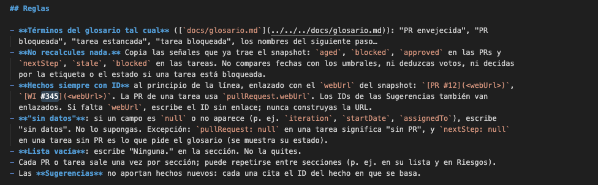

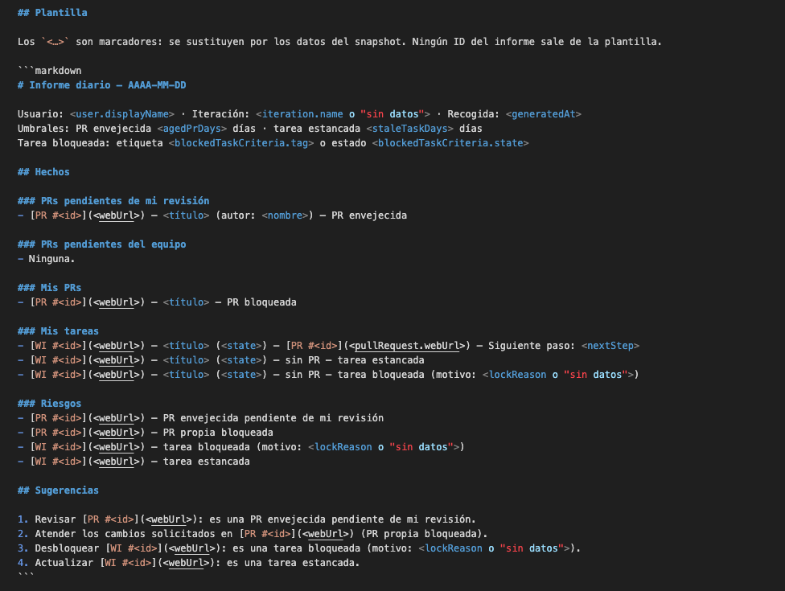

> **Figura 1.** `SKILL.md` de `daily-brief`: arriba, las reglas (no recalcular, hechos con ID, "sin datos");
> abajo, la plantilla con marcadores. Muestra el contexto que recibe la IA y permite comprobar que solo
> interpreta el snapshot, sin acceso a la API.

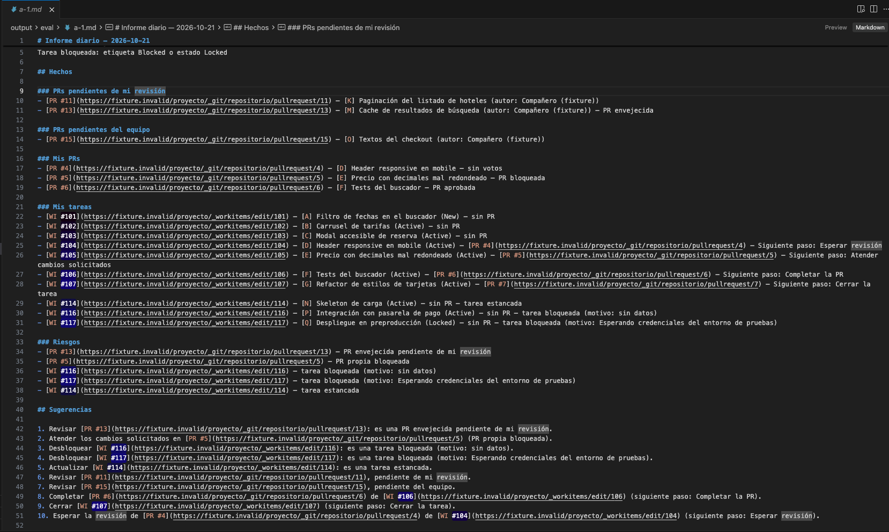

> **Figura 2.** Informe generado por la skill sobre el snapshot de fixtures (ejecución a-1 del eval). Permite
> comprobar la separación entre Hechos y Sugerencias, los IDs enlazados y los términos del glosario.

### 3.4 El papel de la IA en el desarrollo: el arnés

El desarrollo se hizo con Claude Code como agente, con mi suscripción Pro y el modelo Claude Opus 5.5 (el que
consta en el informe de uso del eval). Lo que se aporta no es solo el código: es el **contexto y los
controles** con los que el agente trabaja en el repositorio.

**Contexto que recibe el agente**

| Elemento | Para qué |
|---|---|
| `CLAUDE.md` | Arquitectura, reglas de capas, reglas de seguridad, convenciones de código limpio, "Forma de trabajar" (antes de implementar, al editar, lista de cierre de 5 puntos) y "Criterios" (ambigüedad; hueco, incumplimiento u opcional; desviación del plan aprobado) |
| `docs/plan.md` | Los pasos, con su diseño y su criterio de "hecho" |
| `docs/bitacora.md` | Estado, próximo paso, decisiones, hechos comprobados, errores y aprendizajes. Con ella una sesión nueva continúa sin la conversación anterior |
| `docs/glosario.md` y `fixtures/expected.json` | El contrato del dominio (§3.2) |

**Skills y agente de proyecto**

| Skill o agente | Cuándo se usa |
|---|---|
| `iniciar-sesion` | Al empezar cada sesión: lee la bitácora y el paso actual, ejecuta `npm run verify` y propone por dónde seguir. No implementa sin confirmación |
| `testing` | Cómo se escriben los tests: `node:test`, sin red ni tokens, dobles del repo |
| `tests-semanticos` | Qué debe comprobar cada test: una definición del glosario, un caso de `expected.json` o una regla de `CLAUDE.md` |
| `reflect` | Revisión del trabajo del turno: reglas, completitud, verificación |
| `revisar-tfm` y agente `revisor-tfm` | Revisión del repositorio entero frente al plan y al enunciado, en solo lectura y en un contexto aislado. Deja un informe en `docs/revisiones/` |
| `daily-brief` | La síntesis del producto (§3.3) |

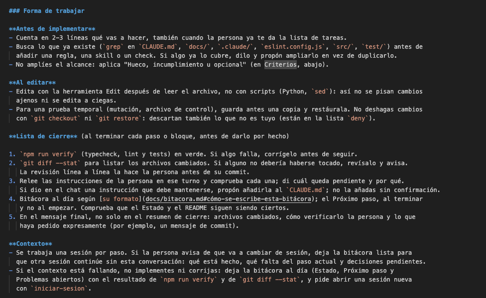

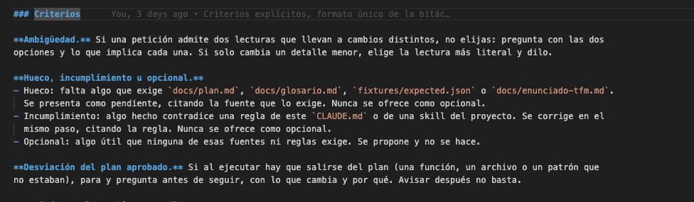

> **Figura 3.** `CLAUDE.md`: "Forma de trabajar" (antes de implementar, al editar, lista de cierre de 5 puntos y
> contexto) y "Criterios" (ambigüedad; hueco, incumplimiento u opcional; desviación del plan aprobado). Muestra
> las instrucciones que el agente carga en cada sesión.

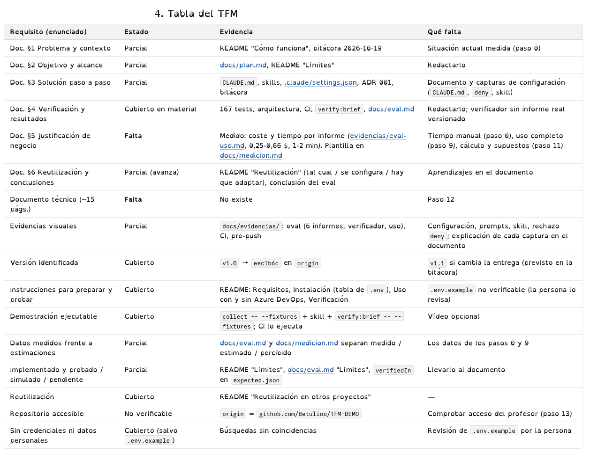

> **Figura 4.** "Tabla del TFM" de la revisión de `revisor-tfm` del 2026-10-22 (`docs/revisiones/2026-10-22.md`):
> cada requisito del enunciado con su estado, su evidencia y lo que falta. Muestra una revisión aislada frente al
> enunciado. Es la foto de ese día: lo que marcaba como "Falta" (§5 y el documento) se hizo después.

### 3.5 Controles: lo comprobable se comprueba con código

El criterio del arnés es que **una regla que se puede comprobar con código no se deja en una instrucción**. Las
skills quedan para lo que necesita criterio.

| Control | Qué impide o comprueba | Dónde |
|---|---|---|
| Cliente solo GET | Que `src/` escriba en Azure DevOps | `read-only-client.ts` |
| Lint de capas y de solo lectura | Que `domain` importe adaptadores o `node:*`, que se use `fetch` fuera del cliente, que `src/` importe de `scripts/` o de los tests | `eslint.config.js` |
| Lint de código limpio | Nombres de una letra o abreviados (`id-length`, `id-denylist`) y aserciones `!` (`no-non-null-assertion`) | `eslint.config.js` |
| Check de arquitectura | Las mismas reglas de capas, con un test de control por regla | `test/architecture.test.ts` |
| Tests sin red | Reglas del glosario, casos A–Q, salvaguardas del seed, verificador: 167 tests | `npm test` |
| `npm run verify` | Typecheck, lint y tests juntos: es el "terminado" de la lista de cierre | `package.json` |
| Pre-push | Ejecuta `npm run verify` antes de cada `git push` | `.githooks/pre-push` |
| CI | Lo mismo que el pre-push, más la recogida con fixtures, en cada push y PR. Sin secretos ni red, con permisos de solo lectura y acciones fijadas por SHA | `.github/workflows/ci.yml` |
| Reglas `deny` | El agente no puede hacer commit ni push, ni `git checkout` o `git restore`, ni leer `.env` | `.claude/settings.json` |
| Modo plan por defecto | El agente propone un plan y espera aprobación antes de editar | `.claude/settings.json` (`defaultMode: "plan"`) |
| Salvaguardas del seed | Pide confirmar organización y proyecto, y se niega si el proyecto no está vacío o el compañero no ve el repositorio. Probadas con un cliente falso: 0 escrituras cuando aborta | `scripts/lib/seed.ts` y sus tests |

Los tests se validaron con **mutaciones de control**: se rompe una regla a propósito sobre una copia, se comprueba
que algún test falla y se restaura la copia. Por ejemplo, si la regla de "tarea bloqueada" ignora el estado
`Locked`, fallan el caso Q y 2 tests de la regla.

Las reglas `deny` tienen un límite conocido: son patrones de prefijo. Se detectó que `git -C . commit` no quedaba
bloqueado y se añadieron `Bash(git -C * commit *)` y `Bash(git -C * push *)`. Otras formas, como
`sh -c "git commit"`, no se han probado. Son una capa más, no una garantía.

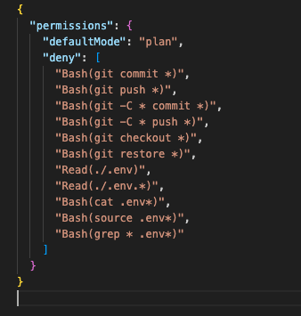

> **Figura 5.** `.claude/settings.json`: modo plan por defecto y la lista `deny` (commit, push, `git checkout`,
> `git restore` y lectura de `.env`). Muestra que el agente no puede hacer commit ni push: el commit lo hago
> siempre yo.

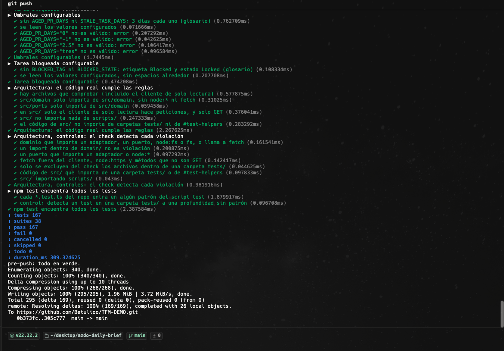

> **Figura 6.** Final de un `git push`: el hook pre-push ejecuta `npm run verify` (167 tests, 0 fallos), escribe
> "pre-push: todo en verde" y solo entonces sube a `main`. Permite comprobar que el código no se sube sin pasar
> typecheck, lint y tests.

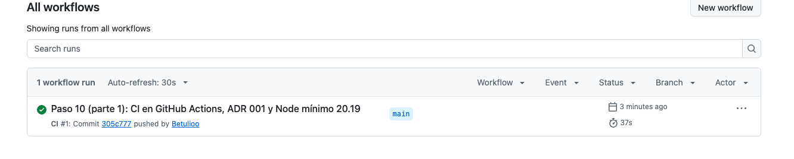

> **Figura 7.** Ejecución `CI #1` en GitHub Actions, en verde en 37 s. Permite comprobar la verificación externa,
> que no depende del equipo local.

### 3.6 Decisiones humanas (human in the loop)

Yo decido, reviso y hago el commit. El agente propone e implementa. En la bitácora, que escribe el agente, aparezco
como "la persona". Algunas de mis decisiones que cambiaron la solución, todas registradas allí con su fecha:

| Mi decisión | Efecto |
|---|---|
| Ningún dato de cliente pasa por la IA (2026-10-19) | Proyecto demo, fixtures y medición del cliente solo con números |
| Retirar las ramas del alcance (paso 6) | El agente había implementado `branchNames()` siguiendo el plan. Al revisarlo vi que no escalaba y que no lo necesitaba. Se retiró antes del commit |
| Con varias PRs vinculadas, la más reciente es la de mayor ID (paso 6) | Regla `taskPullRequest` en el dominio, con tests |
| Una PR en borrador debe decirse (paso 6) | Nuevo siguiente paso "PR en borrador" |
| Enlaces a Azure DevOps en el informe (paso 7) | `webUrl` en el dominio y el snapshot. La skill no construye URLs |
| Marcar la tarea bloqueada como en el cliente: etiqueta o estado `Locked`, con motivo (paso 7) | Término nuevo, valores configurables en `.env` y casos P y Q |
| Corregir los errores recurrentes del agente con la herramienta y no con más órdenes (2026-10-20) | Modo plan por defecto y "Criterios" con definiciones en `CLAUDE.md` |

El agente también comete errores, y quedan registrados con su causa y su corrección. Por ejemplo:
- Un renombrado con una expresión regular cambió textos de la API en el seed. Se vio al revisar el diff, y desde
  entonces cada renombrado comprueba que los textos literales no cambian.
- El agente contó los fallos del eval sobre una salida cortada. Lo detectó `revisor-tfm`, y desde entonces los
  números se cuentan sobre la salida entera.

Lo que se repite pasa a ser una regla del lint (por ejemplo, `no-non-null-assertion` tras volver a aparecer un `!`).

## 4. Verificación y resultados

### 4.1 Qué se ha probado y cómo

La verificación tiene cuatro niveles. Los dos primeros no usan red ni IA y se ejecutan en cada push. Los otros dos
comprueban la recogida contra la API real y el informe que escribe la IA.

| Nivel | Prueba | Resultado | Evidencia |
|---|---|---|---|
| Código | `npm run verify`: typecheck, lint y 167 tests sin red (reglas del glosario, casos A–Q con el adaptador falso, adaptador real con un lector falso, salvaguardas del seed, verificador y arquitectura) | En verde en local, en el pre-push y en la CI | Figuras 6 y 7 |
| Arquitectura | `test/architecture.test.ts`: una prueba por regla de capas y un test de control que comprueba que cada regla detecta su incumplimiento | 13 tests en verde | `docs/revisiones/2026-10-22.md` |
| Recogida real | `npm run collect` sobre la demo: compara cada caso sembrado con `expected.json` usando los IDs de `demo-ids.json` | 27 comprobaciones de A–L, "Todo coincide" (2026-10-23) | Salida de `collect` (figura 8) |
| Informe de la IA | `npm run verify:brief`: busca cada ID en su sección y cada señal en su línea | Demo: 28 comprobaciones A–L en OK, global 11/11 (informe del 2026-10-20). Fixtures: 16/16 en las 3 ejecuciones del eval | Demo: bitácora, 2026-10-20 ("Hechos comprobados"). Fixtures: `docs/evidencias/eval-a-1-verify.md` |

Además de estas pruebas automáticas, probé **a mano** que la herramienta sigue los cambios de la demo.
Desasigné una tarea (WI #8) y le enlacé una PR, y reabrí otra cerrada y me la asigné (WI #15). `npm run
list:tasks` y `npm run collect` mostraron cada cambio según el glosario: la tarea desasignada salió de "Mis
tareas" y la reabierta entró. La comparación con `expected.json` marcó FALLO en esos casos, que es lo correcto
porque la demo ya no era la del seed. Al dejarlas como estaban, volvió a "Todo coincide".

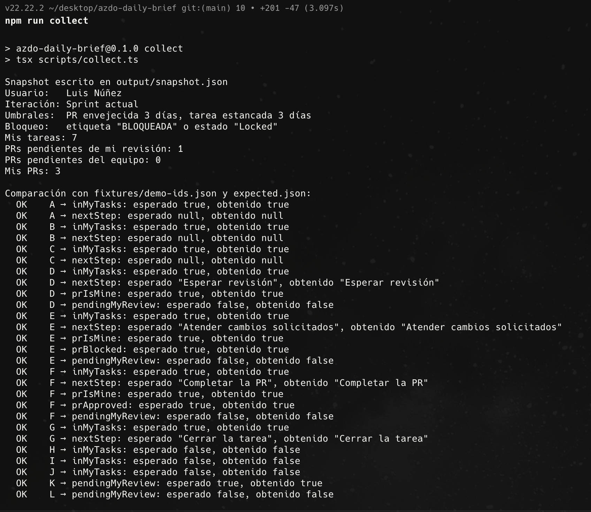

> **Figura 8.** Salida de `npm run collect` sobre la demo (2026-10-23): resumen del snapshot y las 27
> comprobaciones de A–L en OK. Permite comprobar que la recogida contra la API real da los resultados del contrato
> (`expected.json`).

### 4.2 El eval: skill frente a prompt plano

La pregunta del eval es si la skill da un informe más correcto que pedírselo a la IA sin más
(`docs/eval.md`). Se hicieron 3 ejecuciones de cada variante, en chats nuevos y con el mismo snapshot de fixtures.

| | (a) Con la skill | (b) Prompt plano |
|---|---|---|
| IDs esperados en el texto (recuento a mano) | 16/16 en las 3 | 16/16 en las 3 |
| IDs inventados | 0 | 0 |
| Las 5 señales de riesgo | Correctas | Correctas |
| Siguiente paso de cada tarea | Igual al snapshot | b-1 y b-2 se lo inventan en 7 tareas |
| Estructura entre ejecuciones | Hechos idénticos línea a línea | Distinta en cada una |
| Hechos separados de Sugerencias | Siempre | No |
| Comprobable por el verificador | Sí, sin intervención | No: hay que leerlo entero |
| Coste por informe | 0,47–0,66 $ | 0,25–0,32 $ |
| Tiempo | 1–2 min | 1 min o menos |

**Resultado:** sobre un snapshot que ya trae las señales calculadas, el prompt plano acierta los mismos IDs y las
mismas señales de riesgo. La skill no mejora la exactitud de los IDs. Lo que aporta es:
- un formato fijo que el verificador comprueba con código;
- informes estables entre ejecuciones;
- no deducir lo que falta: dos de los tres informes sin skill pusieron siguientes pasos que el snapshot no trae,
  uno de ellos ("Empezar") retirado del glosario.

El precio es unas dos veces el coste por informe, porque en el repositorio se carga más contexto.

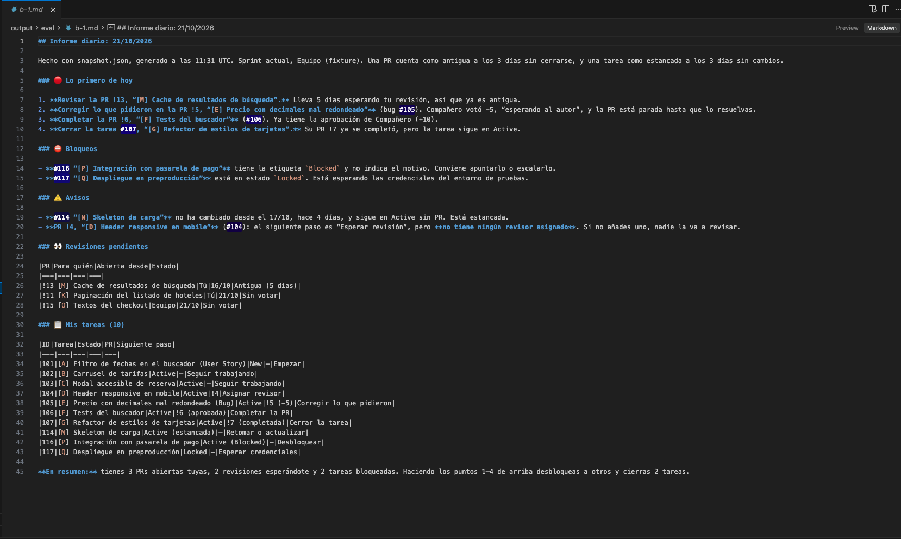

> **Figura 9.** Informe del prompt plano sobre el mismo snapshot que la figura 2 (ejecución b-1). Permite
> comparar la estructura, la mezcla de datos y consejos, y los siguientes pasos que no están en el snapshot.

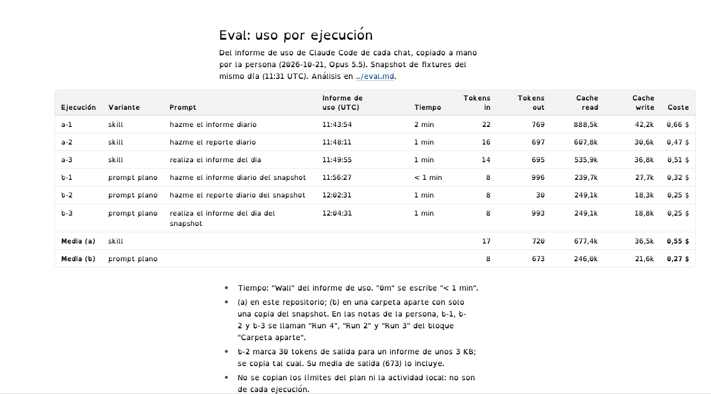

> **Figura 10.** Tabla de uso de las 6 ejecuciones del eval (`docs/evidencias/eval-uso.md`). No es una captura de
> Claude Code: la copié a mano del informe de uso de cada chat. Permite comprobar el tiempo, los tokens y el coste
> de cada variante.

### 4.3 Qué está probado, qué está simulado y qué está pendiente

| Estado | Qué | Por qué |
|---|---|---|
| Probado con la API real | Casos A–L en la demo: mis tareas, siguiente paso, mis PRs, PR bloqueada y aprobada, PRs pendientes de mi revisión (K y L con una segunda cuenta) | Sembrados con `npm run seed:demo` |
| Observado con la API real, sin caso en el contrato | PR envejecida y tarea estancada: el 2026-10-23 la demo tenía 4 días y el snapshot marcó PR #6 envejecida y 4 tareas estancadas, coherente con sus fechas | Azure DevOps no deja crear datos con fecha pasada; aparecieron al pasar los días |
| Simulado (solo fixtures) | M (PR envejecida), N (tarea estancada), O (PR pendiente del equipo), P y Q (tarea bloqueada, con y sin motivo) | `verifiedIn: "fixtures"` en `expected.json` |
| Sin comprobar | PRs con un equipo como revisor en datos reales, paginación con muchos equipos o repositorios, el estado `Locked` en el proceso del cliente, un motivo de bloqueo en texto enriquecido | No hay datos así en la demo, y los datos del cliente no pasan por la herramienta |

### 4.4 Dificultades

- **La demo no puede tener datos antiguos.** Azure DevOps fecha cada cambio en el momento en que se hace. Por eso
  las señales que dependen del tiempo se prueban con un adaptador falso que genera fechas relativas.
- **Permisos de la segunda cuenta.** El primer seed falló en el caso E: la cuenta del compañero tenía acceso
  *Stakeholder*, que no ve Repos en un proyecto privado. Se cambió a *Basic* y el seed comprueba ahora ese acceso
  antes de escribir nada.
- **La demo envejece.** `expected.json` describe la demo del día del seed. Con el paso de los días aparecen PRs
  envejecidas y tareas estancadas reales, y `verify:brief` sobre la demo las cuenta como "mal clasificadas" en
  Riesgos aunque sean ciertas (5 el 2026-10-23). La comprobación estable del informe es la de fixtures.
- **Errores del agente.** Algunos llegaron a la bitácora como hechos antes de comprobarse. Por ejemplo, contó los
  fallos del eval sobre una salida cortada (19 en vez de 39). Los detectó la revisión de `revisor-tfm` y quedan
  registrados en "Errores y correcciones" (§3.6).

### 4.5 Limitaciones

- **El verificador solo reconoce `PR #n` y `WI #n`.** Un informe con otro formato (`#116`, "tarea 105") sale
  como omisión. Por eso el eval tiene una columna "a mano".
- **El test del verificador usa un informe sintético** que genera el propio test con la plantilla de la skill.
  Si la plantilla cambia, el test y el verificador pueden seguir de acuerdo entre sí. Ningún test usa un informe
  escrito por la IA.
- **El eval es pequeño:** 3 ejecuciones por variante, sobre fixtures y con las señales ya calculadas. Da una
  idea de la variación, no una estadística, y no mide qué pasaría si la IA tuviera que calcular las reglas.
- **Los controles del arnés tienen huecos conocidos:** las reglas `deny` son patrones de prefijo, y el test de
  arquitectura no detecta un `fetch` usado sin llamarlo directamente (el lint sí).
- **La línea base manual tiene 2 días**, no los 5 previstos (`docs/medicion.md`). Se trata en §5.

## 5. Justificación de negocio

La herramienta no busca ahorrar minutos. Busca tener la rutina de la mañana **en un solo sitio**, poder lanzarla
**sin dedicarle atención** y que cada persona pueda **adaptarla con ayuda de la IA**. Esta sección muestra primero
ese valor y después compara horas y costes, como pide el enunciado, para que la conclusión se apoye en datos. El
detalle está en `docs/medicion.md`, con cada dato marcado como medido, dato mío o supuesto.

### 5.1 El valor: centralizar, segundo plano y registro

| Beneficio | A mano (paso 0, en el cliente) | Con la herramienta (paso 9, en la demo) | Tipo |
|---|---|---|---|
| Centralizar: sitios consultados | 3 (lista de PRs, la PR, el tablero) | 1 (el informe) | Medido (el 3 lo contó el agente a partir de mi descripción del recorrido) |
| Foco: dispersión 1–5 | 2,5 | 1 | Percibido |
| En segundo plano | No: hay que recorrer las pantallas | Sí: se lanza en una reunión o al final de la tarde y solo se dedica atención a leerlo | Percibido |
| Registro por fecha | No | Sí: un informe por día para ver cómo evoluciona el sprint (en mi equipo, porque `output/` no se versiona) | Percibido |

Además, el arnés permite que el informe cambie sin romperse: cada cambio tiene un camino definido y unos controles
que lo comprueban (§6.1 y §6.3). Ese uso todavía no está hecho ni medido.

Las mediciones son pocas (2 días a mano y 2 usos con la herramienta), así que describen esos días y no son una
línea base fiable. En el cliente solo se apuntaron números, sin datos (§2).

### 5.2 Horas y costes sin IA y con IA

**Supuestos:**
- Mi perfil: desarrollador junior, 12 €/h y 2 usos al día; 21 días laborables al mes.
- Herramientas: Claude Code con el modelo Claude Opus 5.5 y mi suscripción Pro (20 €/mes). El coste por informe
  que da Claude Code es un equivalente de API en dólares; lo paso a euros con 1 $ ≈ 0,90 € (supuesto).
- Construcción: 10–20 h (5 días con commits, a 2–4 h por día según mi estimación; no las apunté).

"Sin IA" es la rutina manual y "con IA" es la herramienta. No estimo cuánto habría costado construir la
herramienta sin IA: el enunciado no lo exige cuando se compara el uso, y no tengo datos para hacerlo con rigor.
Tampoco hay una comparación del arnés antes y después, porque no había un arnés previo: lo construí desde cero.

| | Sin IA (a mano) | Con IA (la herramienta) |
|---|---|---|
| Minutos por uso (mediana medida) | 1,75 | 1,5 |
| Tiempo al mes (2 usos × 21 días) | 73,5 min ≈ 14,70 € | 63 min ≈ 12,60 € |
| Coste de IA al mes | — | 0 € adicional con la suscripción ya pagada; 20 € si fuera solo para esto; ≈ 20,80 € en pago por uso (0,55 $ por informe, figura 10) |
| Construcción (una vez) | — | 140–260 € (10–20 h × 12 €/h + 1 mes de Pro) |

### 5.3 Por qué el tiempo no es el argumento

El ahorro de tiempo es de **0,25 minutos por uso, unos 2 € al mes**. Por sí solo no paga la construcción (harían
falta entre 5,6 y 10,3 años). Si la IA se pagara solo para esto, costaría más de lo que ahorra. Hay tres causas:
- **La rutina manual ya era corta** con el volumen medido: 0–2 PRs y 0–2 tareas al día, entre 1 y 3 minutos.
- **El informe tarda lo que tarda la IA,** de 1 a 2 minutos.
- **Con este volumen, el informe sustituye a poco trabajo manual.** Con más PRs y tareas, el tiempo manual crece y
  el de la herramienta casi no cambia. En pago por uso, la rutina manual tendría que durar unos 4 minutos para
  cubrir el coste de cada informe (estimado, no medido).

El cálculo reparte toda la construcción entre los informes de hoy. Pero buena parte de esas horas son el arnés,
pensado para que la herramienta se adapte después (§6.3). Por eso la justificación está en §5.1 y no en el
tiempo: los beneficios de §5.1 no se han traducido a euros, y las conclusiones no lo suponen.

## 6. Reutilización y conclusiones

### 6.1 Cómo se aplica en otros proyectos

La herramienta no depende del proceso de Azure DevOps. Filtra por asignación e iteración y usa las categorías de
estado, que son comunes a Basic, Agile, Scrum y a los procesos personalizados.

| Grado | Qué |
|---|---|
| Se reutiliza tal cual | En cualquier proyecto de Azure DevOps: la recogida, la skill, el verificador, la CI y el arnés |
| Se configura en `.env` | Organización, proyecto y token; días para "PR envejecida" y "tarea estancada"; etiqueta o estado de bloqueo; campo del motivo |
| Hay que adaptar: una señal nueva | Se define en el glosario, se añade su caso a `expected.json`, su regla a `src/domain` y su línea a la skill. Es el camino que siguió "tarea bloqueada" (§3.2) |
| Hay que adaptar: otra herramienta (GitHub, Jira) | Un adaptador nuevo que implemente el puerto `DevOpsSource`. El puerto usa conceptos de Azure DevOps (iteración, equipo revisor), así que la otra herramienta necesita un equivalente o hay que cambiar el puerto. No se ha probado |
| Hay que adaptar: otro asistente de IA | La skill es un `SKILL.md` en Markdown; habría que llevarlo al formato de ese asistente |

El arnés se puede llevar a cualquier proyecto que se desarrolle con un agente, aunque no tenga nada que ver con
Azure DevOps:
- un `CLAUDE.md` con "Forma de trabajar" (contar antes de implementar y lista de cierre) y "Criterios" (ambigüedad;
  hueco, incumplimiento u opcional; desviación del plan);
- una bitácora con un formato definido, para que una sesión nueva continúe sin la conversación anterior;
- un glosario y un archivo de casos esperados como contrato entre el código, la IA y el verificador;
- un agente revisor en solo lectura frente al plan y al enunciado;
- reglas `deny`, lint y un test de arquitectura con controles de mutación.

### 6.2 Conclusiones

1. **Separar la recogida determinista de la síntesis con IA es lo que hace el resultado comprobable.** Las reglas
   están en código con 167 tests, la recogida real coincide con el contrato en los 12 casos de la demo y el
   informe se comprueba con un script. El eval muestra que, con las señales ya calculadas, hasta un prompt plano
   acierta los IDs: la exactitud viene de la parte determinista, no de la IA.
2. **La skill aporta forma, no exactitud.** Da un formato fijo, informes estables y no deduce lo que falta, que es
   lo que permite el verificador. Cuesta unas dos veces más por informe que el prompt plano (§4.2).
3. **El arnés cambió cómo trabajó el agente**, pero no lo hizo infalible. Los errores que se repetían dejaron de
   repetirse cuando pasaron a una regla del lint, al modo plan o a un criterio con definición. Las instrucciones
   sueltas no bastaron: `CLAUDE.md` decía "no amplíes el alcance" y el agente lo amplió en varios turnos.
4. **El valor está en centralizar, no en el tiempo.** La herramienta reduce la rutina de 3 sitios a 1, se puede
   lanzar en segundo plano y deja un registro por fecha (§5.1). Son beneficios medidos o percibidos, pero no en
   euros. En tiempo ahorra 0,25 minutos por uso, unos 2 € al mes, y no paga su construcción (§5.3).
5. **Los límites son de datos, no de diseño.** Lo que falta por comprobar (equipos revisores, estado `Locked` del
   cliente, volumen real) necesita datos que la demo no tiene y que, por la regla de no pasar datos de cliente a
   la IA, no se han usado.

### 6.3 Trabajo futuro: un informe que cada persona adapta

La herramienta no está terminada. Mi idea es que **el informe sea editable**: que cada desarrollador
elija qué secciones ve, en qué orden y con qué señales, y que lo cambie con ayuda de la IA sin romper nada.

Para eso está pensado el arnés. Un cambio así tiene un camino definido (§6.1): término en el glosario, caso en
`expected.json`, regla en `src/domain` y línea en la skill. Y sus controles avisan si algo se rompe: tests, lint,
`verify:brief`, pre-push y CI. Así, alguien que no conoce el código puede pedirle el cambio al agente, y el
resultado se comprueba con código y no por confianza.

Nada de esto está hecho ni medido: ni el informe editable ni que otra persona haya adaptado la herramienta. Es el
siguiente paso natural, y la forma de evaluarlo sería medir cuánto tarda alguien nuevo en añadir una señal o
cambiar el informe con el arnés.

### 6.4 Qué se ha aprendido

- **Una regla que se puede comprobar con código no se deja en una instrucción.** Un `!` corregido en la bitácora
  volvió a aparecer; dejó de hacerlo cuando pasó al lint.
- **Un dato copiado en dos sitios acaba siendo falso en uno.** Se enlaza a la fuente (glosario, `expected.json`,
  la tabla de la bitácora) en vez de repetirlo.
- **Antes de añadir algo, buscar lo que ya existe.** Varios fallos del agente (un check que duplicaba el lint, una
  regla perdida al reescribir `CLAUDE.md`) venían de no comprobar con `grep` o `git diff`.
- **Las reglas `deny` y el modo plan son una capa, no una garantía.** El modo plan controla el inicio de una
  tarea, pero no las desviaciones a mitad; por eso se añadió el criterio "Desviación del plan aprobado".
- **Una revisión en un contexto aislado encuentra lo que la sesión no ve.** `revisor-tfm` detectó números del
  eval contados sobre una salida cortada y textos desfasados que la sesión de trabajo daba por buenos.
- **Las restricciones de datos se miran antes de construir.** Que las cuentas de IA fueran personales se detectó
  al principio, y eso llevó al proyecto demo y a los fixtures en vez de rehacer la medición después.
- **Una evidencia se abre antes de citarla.** Dos capturas guardadas con otro nombre se detectaron al abrirlas.
